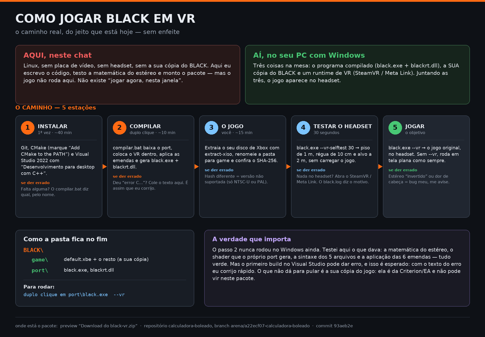

# Passo a passo (sem mexer em código)



Este repositório é o **módulo de VR**, não o jogo pronto. Para jogar BLACK no headset você precisa de
três coisas, nesta ordem:

| # | O que | De onde vem |
|---|---|---|
| 1 | **A sua cópia do BLACK** (o `default.xbe` do Xbox) | ✅ **já resolvido** — a que você pôs no Drive é a NTSC-U original |
| 2 | **O programa compilado** (`black.exe` + `blackrt.dll`) | sai do `compilar.bat` deste pacote |
| 3 | **Um runtime de VR** instalado | SteamVR, Meta Quest Link, WMR, Virtual Desktop… |

O pacote só traz o código do módulo de VR e as emendas no port. Ele **não** traz o jogo e **não** traz
programa pronto — o jogo é da Criterion/EA, e compilar é o passo 2 abaixo.

---

## 1. Instale as duas ferramentas (uma vez só)

- **Git** — https://git-scm.com/download/win (avançar, avançar, concluir).
- **CMake** — https://cmake.org/download/ → instalador Windows. Na tela de opções, escolha
  **"Add CMake to the system PATH"**.
- **Visual Studio 2022 Community** — https://visualstudio.microsoft.com/pt-br/downloads/
  No instalador, marque **"Desenvolvimento para desktop com C++"**. (É grande; pode ir tomando um café.)
- **Runtime de VR** — se você usa SteamVR, ele já serve. Se usa Quest por cabo/air link, o app da Meta
  instala o runtime sozinho. Se não tem nenhum, o jogo ainda roda em tela plana.

### Você já tem o port 0.2.0 instalado?

Ótimo — o `compilar.bat` foi feito para rodar **em cima** dessa instalação, sem apagar nada:

- ele acha o `default.xbe` sozinho (inclusive dentro de `game\`);
- confere o hash do seu jogo e te avisa se não for NTSC-U/PAL;
- compila a versão **0.3.0 + VR** e instala em `port\`;
- guarda o programa antigo em `_port-antigo\`;
- leva os saves de `game\savedata` para `port\savedata` e o `black.ini` junto;
- cria `TESTAR-OCULOS.bat` e `JOGAR-VR.bat` na pasta principal.

O 0.3.0 traz, entre outras coisas, o **lean** (inclinar/inclinação lateral) que o módulo de VR usa como
base do movimento de cabeça — por isso a versão de base é essa e não a 0.2.0.

## 2. Compile (um duplo clique)

1. Extraia o pacote em qualquer pasta (por exemplo `C:\BLACK VR\`).
2. Dê **duplo clique em `compilar.bat`**.
3. Ele baixa o port, coloca o VR dentro, aplica as emendas e compila. Leva alguns minutos na primeira vez.

No fim ele mostra onde ficaram os dois arquivos:

```
...\_fork\black-pc\loader\build\Release\black.exe
...\_fork\black-pc\loader\build\Release\blackrt.dll
```

> Se aparecer `[ERRO]`, o bat diz o que fazer. Se for erro de compilação (`error C...`), **copie o
> texto e mande para o agente** — é assim que ele corrige o código, e é rápido.

## 3. A sua cópia do jogo

Você precisa do **BLACK de Xbox, NTSC-U (América) ou PAL Europa**. Outras versões têm endereços
diferentes e não funcionam.

1. Extraia o disco com o [extract-xiso](https://github.com/XboxDev/extract-xiso):
   `extract-xiso -x Black.iso`
2. Renomeie a pasta extraída para `game`.
3. Confira que é a versão certa. **O jeito fácil:** duplo clique em **`conferir-jogo.bat`** e
   arraste a pasta do jogo para a janela — ele calcula o SHA-256, diz "SERVE" ou "NÃO SERVE" em
   português e grava um `LISTA.txt` para você colar no chat.

   Na mão, se preferir (PowerShell):
   ```powershell
   Get-FileHash game\default.xbe -Algorithm SHA256
   ```
   - NTSC-U: `DF2739C372D254A90AEECCF5971D12097F22D89FBB90DB021FDA96DD4DEB68F6`
   - PAL: `67F35121CCF622E7A293C402219596FE6456CA4C3D27E6F8139E449264DA30F0`

### Atenção: cópia traduzida (PT-BR) não serve

Só funcionam as duas versões **originais** listadas acima, com o hash exato. Pacotes "PT-BR",
"traduzido", "repack" ou "versão PC nativa" que circulam por aí quase sempre são uma destas coisas:

- um **XBE traduzido** (fã-tradução): o texto muda, o código muda de endereço e o port não reconhece
  a build — em geral ele recusa; forçando com `--force`, ele trava;
- uma **ISO de PlayStation 2** traduzida: o port é do jogo de **Xbox**, não abre ISO de PS2;
- um **port já compilado** por outra pessoa: aí ele roda, mas em tela plana e sem as nossas emendas.

Se o seu arquivo não bater com um dos dois hashes, o caminho é conseguir o disco de Xbox original
(NTSC-U ou PAL). Não existe atalho aqui.

## 4. Monte a pasta e rode

```
BLACK\
  game\            <- a sua cópia (default.xbe e o resto)
  port\            <- black.exe e blackrt.dll que o compilar.bat gerou
```

Primeiro **teste o headset sem o jogo** (é o teste que separa problema de VR de problema de jogo):

```
port\black.exe --vr-selftest 30
```

Você deve ver, no headset: piso quadriculado de 1 m, régua de 10 cm à esquerda e um alvo laranja a
2 m. Se isso aparecer certo, a camada de VR está boa. Se não aparecer nada, o problema é o headset/
runtime (e o `port\black.log` diz o motivo).

Depois, o jogo:

```
port\black.exe --vr
```

Sem `--vr`, ele roda em tela plana exatamente como o port original.

## 5. Se algo der errado

| Sintoma | O que fazer |
|---|---|
| `--vr-selftest` abre janela e nada no headset | o runtime não está ativo: abra o SteamVR (ou o app da Meta) e tente de novo. O `black.log` mostra o erro. |
| Imagem no headset, mas escala estranha | ajuste `vr_ipd` (no `port\black.ini`): é a distância entre as suas pupilas, em mm. |
| Estéreo parece "invertido" (dói em segundos) | me avise: é bug, não configuração. |
| Travando/lento | reduza a resolução: `--resolution 720` ou `--scale 2`. |
| Jogo abre em tela plana com `--vr` | veja a última linha `[vr]` do `port\black.log` — ela diz exatamente por que o headset não subiu. |

## Onde está a verdade sobre o estado disto

O código passou por testes automatizados de matemática, do shader e de sintaxe (`tests/run.sh`), mas
**nunca foi compilado no Visual Studio** — isso só acontece na sua máquina, no passo 2. Se o primeiro
build falhar, é esperado: mande o erro e eu corrijo.
