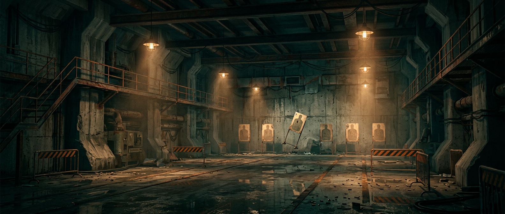

# BLACK VR — Protocolo Zero

> Protótipo de FPS em realidade virtual inspirado em **BLACK** (Criterion Games, 2006), construído do
> zero por **vibecoding** em três stacks: **three.js/WebXR**, **A-Frame** e **Unity/OpenXR**.



<sub>Arte conceitual original gerada para o projeto — não é captura do jogo e não usa assets de BLACK.</sub>

[](#-jogue-agora)
[](./LICENSE)
[](#aviso-legal)

---

## 🎯 Jogue agora

**Sem instalar nada (link público, HTTPS):**
`https://cdn.jsdelivr.net/gh/faek28zero-coder/calculadora-boleado@<COMMIT>/black-vr/`
— troque `<COMMIT>` pelo SHA do último commit. Funciona no navegador do headset; abra a variante
`webxr-three/`. Detalhes em [`docs/COMO-RODAR.md`](./docs/COMO-RODAR.md).

**Ou localmente:**

```bash
python3 -m http.server 8080
```

Abra **http://localhost:8080/** e escolha uma variante. Funciona no desktop (WASD + mouse) e em
headset com navegador WebXR (Quest, Pico, Index via navegador).

| Variante | Caminho | O que é |
|---|---|---|
| **three.js** (principal) | `webxr-three/` | iluminação, partículas, decais, arma procedural, áudio sintetizado, WebXR completo |
| **A-Frame** | `webxr-aframe/` | mesma ideia em HTML declarativo, com componentes próprios |
| **Unity/OpenXR** | `unity/` | scripts C# para build nativo (Quest/PCVR) + guia de montagem da cena |

O hub (`index.html`) tem as três portas de entrada e a documentação.

## 🕹️ O jogo

Estande de tiro industrial abandonado, setor 7. Round de **75 segundos**:

- **Alvos pop-up** sobem atrás de barreiras em 8 pontos diferentes;
- **Zona crítica** no centro do alvo vale **2,5×** mais;
- **Combo** até **x5** — acertar em sequência sobe, errar zera;
- **12 tiros** por carregador, recarga de 1,35 s (com animação e som);
- Dificuldade cresce: mais alvos simultâneos e spawn mais rápido;
- Tela de relatório com pontos, alvos, precisão e melhor combo.

No headset: a arma vive na sua mão, a mira é física e o gatilho dispara. No desktop: mouse capturado,
WASD, `R` para recarregar.

## 🧱 Estrutura

```
black-vr/
├── index.html              hub das três variantes
├── webxr-three/            ★ demo principal (three.js r171 + WebXR)
│   ├── index.html
│   ├── styles.css
│   └── src/                world · targets · weapon · player · effects
│                           textures · audio · hud · main
├── webxr-aframe/           variante declarativa (A-Frame 1.7)
│   └── index.html          componentes inline: popup-target, target-range,
│                           shoot, vr-locomotion, canvas-label, game-state
├── unity/                  scripts C# + guia OpenXR
│   ├── README.md
│   └── Assets/Scripts/     VRPlayerRig · XRWeapon · Target
│                           TargetRangeSystem · GameManagerVR
├── docs/
│   ├── COMO-RODAR.md       setup de cada variante
│   ├── ARQUITETURA.md      decisões técnicas, fluxo do loop
│   ├── PORTS-DO-BLACK.md   pesquisa: os ports nativos de PC do BLACK
│   ├── ROADMAP-VR.md       como levar o BLACK real para VR
│   └── VIBECODING.md       método, prompts e erros do processo
└── vendor/                 three.js + A-Frame vendorizados (offline)
```

Sem `npm install`, sem build, sem CDN em runtime.

## 🔧 Como foi feito

Tudo é **procedural**:

- **Texturas**: concreto, metal, listras de perigo, piso xadrez, silhueta de alvo e buraco de bala
  desenhados em `<canvas>` em tempo de execução (`src/textures.js`).
- **Áudio**: tiro, impacto, recarga e confirmação sintetizados em WebAudio (`src/audio.js`).
- **Arma**: montada com primitivas, com recuo, flash, recarga animada e "sway" (`src/weapon.js`).
- **Cenário**: 28 × 32 m de sala industrial, pilares, passarela, barricadas, poeira e luz de
  emergência (`src/world.js`).

Resultado: repositório leve, nenhum problema de licença de asset e a possibilidade de ajustar qualquer
coisa editando poucos números.

## 🥽 E o BLACK de verdade em VR?

Este repositório tem duas camadas: o **protótipo jogável** (feito) e o **plano para o jogo real**
(documentado). Em outubro de 2026 surgiram ports nativos de PC do BLACK por HLE e recompilação estática
— nenhum com VR. A pesquisa está em [`docs/PORTS-DO-BLACK.md`](./docs/PORTS-DO-BLACK.md) e o plano
técnico (estereoscopia, pose de HMD, viewmodel, conforto) em [`docs/ROADMAP-VR.md`](./docs/ROADMAP-VR.md).

Resumo da estratégia: o `Spark198rus/black-pc` é **GPL-2.0** e troca o Direct3D 8 por D3D9 — é o único
caminho viável e legal para um fork com OpenXR.

## ⚠️ Aviso legal

**BLACK** é obra e marca da **Criterion Games / Electronic Arts**. Este é um **projeto de fã, não
oficial e sem fins comerciais**, sem qualquer vínculo com os detentores dos direitos.

- Nenhum arquivo, modelo, textura, som, mapa ou trecho de código do jogo original está incluído.
- Nada aqui permite jogar BLACK sem possuir o jogo.
- Os ports citados também não distribuem dados do jogo: você precisa da sua própria cópia legal.
- Se algum detentor de direitos solicitar, o conteúdo será removido.

## 📄 Licença

- **Código**: [MIT](./LICENSE).
- **Documentação**: CC BY 4.0.

---

<p align="center"><sub>Feito com vibecoding · setor 7 · protocolo zero</sub></p>
